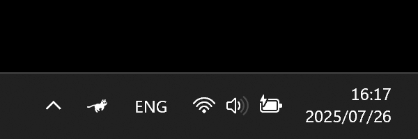
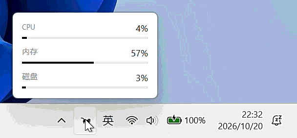

# RustCat

A running cat on your taskbar that sprints with your CPU load.



[](https://github.com/31i45/RustCat/actions/workflows/ci.yml)
[](LICENSE)
[](https://github.com/31i45/RustCat)
[](https://www.rust-lang.org)
[](https://github.com/31i45/RustCat/stargazers)

RustCat is a featherweight Windows tray application that keeps a tiny cat running
in your notification area. The cat's speed follows your CPU load in real time —
idle, it strolls; under load, it sprints.

It is a Rust rewrite of the core of [RunCat365](https://github.com/kyome22/RunCat365)
(C#/.NET), reduced to the single thing that makes RunCat delightful:
**CPU sampling → speed formula → frame animation**. Nothing else.

## Features

- **Live CPU animation** — 5-frame cat animation driven by a Windows PDH
  performance counter (fallback chain: `Processor Information` → `Processor`,
  `% Processor Utility` → `% Processor Time` on pre-26100 builds), smoothed
  over a rolling window.
- **Hover flyout** — hovering the tray icon shows a compact panel with **CPU**,
  **memory** and **disk** activity; per-monitor DPI aware, auto-hides when the
  cursor leaves. Deliberately excludes GPU (no reliable system-wide counter) and
  network (no frame of reference at a glance).

  
  
- **Theme aware** — black cat on light taskbars, white cat on dark ones;
  follows the system theme live (responds to `WM_SETTINGCHANGE`).
- **Run at startup** — left-click the tray icon to toggle; confirmed by a
  checked entry in the right-click menu and a permanent second line in the
  tooltip. Stored in the `HKCU` `Run` key, no settings file required.
- **Featherweight** — a single runtime dependency (the [`windows`](https://crates.io/crates/windows)
  crate), ~0.18 MiB release binary, pure Win32 message loop. No runtime, no
  scheduler, no polling: everything is timer- and message-driven.

## How it works

```
PDH sample (1 s) → rolling average → speed = max(1.0, load / 5.0)
                  → frame interval = 500 / speed  (ms)
```

The busier your CPU, the faster the cat runs — and when the system is idle the
animation deliberately slows down to ~2 fps, exactly like the original RunCat.

The five cat frames are baked into the executable at build time as raw BGRA
pixels (no PNG decoding at runtime), and the `.exe` file icon is generated as a
linker resource with zero external tooling.

## Build

Requirements: Windows 10 or later, Rust (MSVC toolchain).

```sh
git clone https://github.com/31i45/RustCat.git
cd RustCat
cargo build --release
```

The executable is at `target/release/rustcat.exe`.

## Usage

| Action              | Result                                          |
| ------------------- | ----------------------------------------------- |
| Hover the tray icon | Flyout: CPU / memory / disk activity            |
| Left-click          | Toggle *Run at startup* (tooltip second line updates) |
| Right-click         | Menu: **自启** (✓ = enabled), **退出**           |

Exit fully cleans up: tray icon, timers, icons and mutex — no leftovers.

## Design notes

- One dependency, one purpose. No GPU or network meters; no settings
  UI; no persistence beyond the `Run` key.
- Single instance enforced by a named mutex.
- `panic = "abort"`, LTO, `opt-level = "z"` — a static binary with no
  unwinding machinery.
- Build-time assertions guard the icon assets against silent drift; the
  guards live in the unit-test suite, so CI runs them.
- `VS_VERSIONINFO` is hand-assembled in `build.rs` with zero external tooling
  (structure verified via PE dump; property-sheet reading is a known open item).

## Credits

Built as a faithful Rust rewrite of [RunCat365](https://github.com/kyome22/RunCat365)
by [kyome](https://github.com/kyome22). The original concept and the cat
artwork belong to kyome (MIT License).

## License

[MIT](LICENSE)
